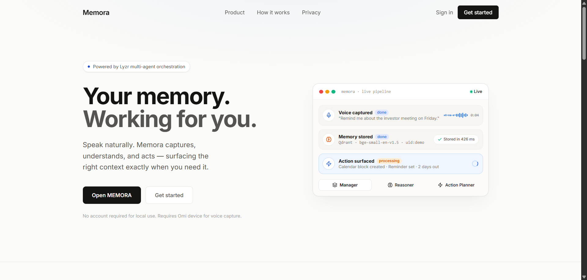
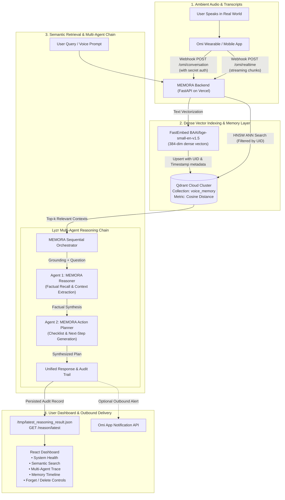

# MEMORA — Voice-Powered Autonomous Memory Assistant

> **Continuous Ambient Intelligence · Semantic Vector Recall · Multi-Agent Sequential Reasoning**

[](https://memora-arh.vercel.app/app)
[](https://memora-1iae.vercel.app/health)
[](https://qdrant.tech)
[](https://studio.lyzr.ai)
[](LICENSE)

<p align="center">
  
</p>

---

## 1. Project Overview

**MEMORA** is a voice-first autonomous memory assistant that bridges ambient physical audio with semantic knowledge synthesis and multi-agent plan execution. Operating silently in the background, MEMORA listens to real-world conversations and audio streams via the **Omi** wearable app, vectorizes knowledge with **FastEmbed** into **Qdrant Cloud**, and activates a sequential multi-agent reasoning chain powered by **Lyzr** to synthesize grounded answers and actionable checklists.

### The Problem
Human memory degrades rapidly under information overload. Important action items, meeting agreements, commitments, and class instructions spoken aloud are routinely lost because taking manual notes creates cognitive friction. Existing voice assistants are reactive, lack persistent semantic context, and struggle to execute structured multi-step plans across days of conversations.

### The Solution
MEMORA creates an autonomous, privacy-conscious memory loop:
1. **Passive Transcription**: Ingests transcripts seamlessly via Omi webhooks.
2. **Semantic Vector Indexing**: Projects speech into 384-dimensional dense vectors with cosine similarity in Qdrant Cloud.
3. **Sequential Multi-Agent Deliberation**: Combines memory retrieval with a two-stage Lyzr reasoning pipeline (MEMORA Reasoner & MEMORA Action Planner).
4. **Permanent Granular Control**: Implements user-scoped memory deletion and forgetting to ensure users retain sovereign control over their knowledge base.

---

## 2. Official Hackathon Track

- **Hackathon**: *The Dawn of the Autonomous AI Builder — Stop Prompting, Solo Agents Hackathon 2026*
- **Organizers**: AI House × HiDevs
- **Selected Build Track**: **Collaborative Multi-Agent Workflows**
  *(Voice-triggered pipelines where specialized agents coordinate through a shared vector memory layer)*
- **Secondary Alignment**: **Privacy-First Knowledge Systems** *(Granular user isolation, fail-closed admin controls, and verified record deletion)*

---

## 3. Live Deployments & Repository

| Component | Target / Environment | URL |
| :--- | :--- | :--- |
| **Frontend Dashboard** | Vercel (React + Vite + Tailwind CSS) | [https://memora-arh.vercel.app/app](https://memora-arh.vercel.app/app) |
| **Public Landing Page** | Vercel SPA | [https://memora-arh.vercel.app](https://memora-arh.vercel.app) |
| **Backend Web Service** | Vercel Serverless Functions (Python ASGI) | [https://memora-1iae.vercel.app](https://memora-1iae.vercel.app) |
| **Backend Health Check** | FastAPI `/health` | [https://memora-1iae.vercel.app/health](https://memora-1iae.vercel.app/health) |
| **Source Code** | Public GitHub Repository | [https://github.com/aruchith08/memora](https://github.com/aruchith08/memora) |
| **Demo Video** | Video Walkthrough (Under 5 mins) | *[MEMORA Demo Video Link Placeholder]* |

---

## 4. End-to-End System Architecture



---

## 5. Technology Stack & Component Roles

### **Omi (Ambient Voice & Conversation Ingestion)**
Omi serves as the voice interface. Transcripts from live physical conversations and streaming chunks are ingested through authenticated webhook endpoints (`POST /omi/conversation`, `POST /omi/realtime`). The backend enforces query-param and header-based secret verification (`OMI_WEBHOOK_SECRET`) to ensure payloads originate exclusively from trusted hardware. Inbound events are deduplicated with an in-memory lock to guarantee idempotent processing. Outbound notification capabilities are integrated to relay synthesized plans back to the wearable screen.

### **Qdrant (Vector Database & Sovereign Memory Layer)**
Qdrant Cloud provides persistent, low-latency approximate nearest neighbor (ANN) vector search. Every conversation snippet is embedded into a 384-dimensional vector using `BAAI/bge-small-en-v1.5` and stored with metadata (`uid`, `source`, `category`, `timestamp`). 
- **Identity Isolation**: A dedicated payload index on the `uid` field enforces server-side scoping so that queries strictly retrieve the active user's records.
- **Privacy & Forgetting**: Supports granular deletion (`DELETE /memories/{id}`) which permanently removes points from the vector space.

### **Lyzr (Multi-Agent Orchestration & Reasoning Chain)**
Lyzr powers the autonomous intelligence engine. Rather than relying on simple single-turn prompts, MEMORA coordinates specialized agents via the Lyzr Agent Studio API:
1. **MEMORA Reasoner** (`6ac7c057b300b2daefd99218`): Focuses strictly on factual grounding, extracting verifiable truths from retrieved Qdrant memories while eliminating hallucination.
2. **MEMORA Action Planner** (`6ac7eba918b1643ee32dad1d`): Takes the Reasoner's output and transforms it into prioritized action checklists and schedules.
3. **Lyzr Manager Agent** (`6ac7ec8f6f28ab116dc67d3b`): Handles single-focus queries and provides fallback orchestration with WebSocket telemetry monitoring.

### **Frontend & Backend Stacks**
- **Frontend**: React 18, Vite, TypeScript, Tailwind CSS, Lucide icons. Client-side SPA routing managed via `vercel.json`.
- **Backend**: FastAPI (Python 3.12/3.11), Uvicorn, FastEmbed, Qdrant Client, Pydantic v2.

---

## 6. Complete API Reference

All routes are implemented and validated:

| Method | Endpoint | Description | Auth / Security |
| :--- | :--- | :--- | :--- |
| `GET` | `/health` | Operational health, vector mode, and collection name | Public |
| `GET` | `/memories` | Recent memories in chronological descending order | Scoped by `DEMO_UID` |
| `POST` | `/memories` | Vectorize and insert a new text memory | `MEMORA_ADMIN_KEY` in production |
| `POST` | `/memories/search` | Semantic vector search with cosine similarity ranking | Scoped by `DEMO_UID` |
| `DELETE` | `/memories/{memory_id}` | Permanently delete/forget a specific memory | Owner verification + `MEMORA_ADMIN_KEY` |
| `POST` | `/reason` | Direct multi-agent reasoning execution | `MEMORA_ADMIN_KEY` in production |
| `GET` | `/reason/latest` | Audit trace of the latest multi-agent reasoning run | Public (sanitized, zero secrets) |
| `POST` | `/omi/conversation` | Ingest completed conversation transcript from Omi | `OMI_WEBHOOK_SECRET` |
| `POST` | `/omi/realtime` | Ingest streaming real-time transcript chunks | `OMI_WEBHOOK_SECRET` |
| `GET` | `/omi/events/{conv_id}` | Check webhook deduplication status | Public |

---

## 7. Security, Privacy & Memory Deletion

- **Zero Secret Exposure**: All credentials (`QDRANT_API_KEY`, `LYZR_API_KEY`, `OMI_WEBHOOK_SECRET`, `MEMORA_ADMIN_KEY`) are managed via environment variables and excluded from version control.
- **Fail-Closed Administrative Gate**: Mutations (`POST /memories`, `DELETE /memories/{id}`, `POST /reason`) fail closed with `401 Unauthorized` in production if `MEMORA_ADMIN_KEY` is not provided.
- **Strict Cross-User Isolation**: Vector searches and deletion requests verify that point records match the caller's authorized `uid`. Attempting to delete another user's memory returns `403 Forbidden`.
- **Permanent Forgetting**: Unlike applications that simply hide records on the frontend, `DELETE /memories/{id}` triggers `client.delete()` in Qdrant Cloud, permanently wiping the vector and payload from the cluster.
- **Serverless Writable Storage**: FastEmbed model caches and observable audit logs are isolated to `/tmp/fastembed_cache` and `/tmp/latest_reasoning_result.json`, ensuring complete compatibility with Vercel's read-only root filesystem.

---

## 8. Environment Configuration & Deployment

### Environment Variables Reference

MEMORA separates configuration from code. Ensure the following environment variables are configured in your `.env` (for local development) or within the **Vercel Project Dashboard** (for cloud production deployment).

| Environment Variable | Required | Description | Example / Default Value |
| :--- | :--- | :--- | :--- |
| `QDRANT_URL` | **Yes** | HTTPS endpoint of your Qdrant Cloud cluster | `https://e3ccc9a4-....us-west-1-0.aws.cloud.qdrant.io:6333` |
| `QDRANT_API_KEY` | **Yes** | Secret API key generated in Qdrant Cloud console | `th1s_is_a_s3cr3t_qd_k3y...` |
| `QDRANT_COLLECTION_NAME`| No | Collection storing dense voice memories | `voice_memory` |
| `LYZR_API_KEY` | **Yes** | API key generated in Lyzr Agent Studio | `sk-default-Q16lENgCJeRH...` |
| `LYZR_AGENT_ID` | **Yes** | Lyzr Agent ID for reasoning & memory orchestration | `6ac7ec8f6f28ab116dc67d3b` |
| `LYZR_MANAGER_AGENT_ID` | No | Secondary/fallback agent ID (auto-mirrored with agent ID) | `6ac7ec8f6f28ab116dc67d3b` |
| `LYZR_USER_ID` | **Yes** | Email/user identifier registered with Lyzr Studio | `ruchith.alok@gmail.com` |
| `LYZR_API_URL` | No | Lyzr chat inference API endpoint | `https://agent-prod.studio.lyzr.ai/v3/inference/chat/` |
| `OMI_APP_ID` | **Yes** | App ID created in the Omi Developer Portal | `01M4E9ECHKVX2R4GKNH4XR7TX1` |
| `OMI_APP_SECRET` | **Yes** | App secret for Omi API & webhook verification | `sk_46cca318be2d4648...` |
| `DEMO_UID` | No | Server-scoped user ID for UI queries & Omi webhook fallback | `memora_demo_user` |
| `CORS_ORIGINS` | No | Comma-separated list of allowed web frontend origins | `https://memora-arh.vercel.app,http://localhost:5173` |
| `ENVIRONMENT` | No | Set to `production` or `development` | `production` |
| `OMI_WEBHOOK_SECRET` | No | Optional webhook secret checked on incoming Omi calls | *(Leave blank for frictionless testing)* |
| `MEMORA_ADMIN_KEY` | No | Admin key guarding mutation endpoints in production | *(Optional administrative secret)* |
| `VITE_API_URL` *(Frontend)* | **Yes** | Backend URL configured in frontend Vercel deployment | `https://memora-1iae.vercel.app` |

---

### Vercel Backend Deployment Guide

When deploying the FastAPI backend to Vercel (e.g., `memora-1iae.vercel.app`):

1. **Open Vercel Project Settings**:
   - Go to your Vercel Dashboard → Select your Backend Project.
   - Navigate to **Settings** → **Environment Variables**.
2. **Add Required Variables**:
   - Add `QDRANT_URL`, `QDRANT_API_KEY`, `QDRANT_COLLECTION_NAME`.
   - Add `LYZR_API_KEY`, `LYZR_AGENT_ID`, `LYZR_USER_ID`.
   - Add `OMI_APP_ID`, `OMI_APP_SECRET`, `DEMO_UID`.
   - Add `CORS_ORIGINS` containing `https://memora-arh.vercel.app`.
   - Select **Production**, **Preview**, and **Development** environments for each variable.
3. **Trigger a Redeployment (MANDATORY)**:
   > [!IMPORTANT]
   > In Vercel Serverless, adding or editing environment variables **does NOT affect running deployments retroactively**. You must trigger a fresh deployment:
   > - In the Vercel Dashboard, go to the **Deployments** tab.
   > - Click the three dots (`...`) next to the current production deployment.
   > - Click **Redeploy** (ensure "Use existing Build Cache" is unticked if you want a clean rebuild).
   > - Wait for the deployment to turn Ready, then check `https://<backend-url>/health` to verify.

---

### Omi Webhook Setup

To connect live speech and recordings from your Omi wearable or mobile app into MEMORA:

1. Open the **Omi Mobile App** → Navigate to **Apps** → Tap **Create / Edit App**.
2. Set the Webhook URL to your backend:
   ```text
   https://memora-1iae.vercel.app/omi/conversation
   ```
   *(Alternative routes also supported: `https://memora-1iae.vercel.app/conversation` and `https://memora-1iae.vercel.app/omi/realtime`)*
3. Enable **App Enabled** toggle and save.
4. Whenever you speak or complete a conversation in Omi, the webhook automatically streams the transcript, titles, and action items directly to MEMORA, which indexes them in Qdrant Cloud.

---

### Local Setup & Verification

#### Prerequisites
- Python 3.11 or 3.12
- Node.js 18+ and npm
- [uv](https://docs.astral.sh/uv/) (recommended for fast Python environments)

#### 1. Clone & Configure Environment
```bash
git clone https://github.com/aruchith08/memora.git
cd memora

# Configure Backend Environment
cp backend/.env.example backend/.env
# Populate QDRANT_URL, QDRANT_API_KEY, LYZR_API_KEY, etc.
```

#### 2. Run Backend
```bash
cd backend
uv run uvicorn app:app --host 127.0.0.1 --port 8000 --reload
```

#### 3. Run Frontend
```bash
cd ../frontend
npm install
npm run dev
# Dashboard opens at http://localhost:5173/app
```

---

## 9. Test Results & Verification

All automated test suites pass cleanly:

```bash
# 1. Run Unified Deployment & Security Test Suite (23 Tests)
uv run --directory backend -m unittest test_unified_deployment.py
# Result: Ran 23 tests in 2.68s — OK

# 2. Run Multi-Agent Orchestration & Lyzr Telemetry Suite (29 Tests)
uv run --directory backend -m unittest test_collaborative_workflow.py test_lyzr_service.py test_lyzr_telemetry.py
# Result: Ran 29 tests in 9.74s — OK

# 3. Run Frontend Typecheck & Production Build
npm --prefix frontend run build
# Result: 1,620 modules transformed into dist/ — 0 type errors
```

---

## 10. Demo Video Plan (3–4 Minutes)

- **Video Filename**: `MEMORA_Hackathon_Demo.mp4`
- **Recommended Length**: 3 minutes 30 seconds
- **Structure**:
  1. **0:00–0:25**: Introduction to MEMORA, the problem of memory decay, and the solution.
  2. **0:25–1:00**: Architecture walkthrough (Omi voice capture → Qdrant vector memory → Lyzr collaborative agents).
  3. **1:00–1:40**: Live Dashboard overview ([memora-arh.vercel.app/app](https://memora-arh.vercel.app/app)) showing connected backend and the 5 indexed demo memories.
  4. **1:40–2:20**: Live semantic search demonstration querying *"What should I prepare for my MSF class?"* (MSF class memory ranks #1 with ~78% relevance).
  5. **2:20–3:00**: Memory deletion & privacy control demo (forgetting a memory with permanent Qdrant removal).
  6. **3:00–3:30**: Conclusion, live URLs, and GitHub repository.

---

## 11. Submission Metadata

- **Project Name**: MEMORA
- **Project Title**: MEMORA — Voice-Powered Autonomous Memory Assistant
- **Track**: Collaborative Multi-Agent Workflows
- **Live Frontend**: https://memora-arh.vercel.app/app
- **Live Backend**: https://memora-1iae.vercel.app
- **Repository**: https://github.com/aruchith08/memora
- **Solo Participant Entry**: Developed for the Stop Prompting, Solo Agents Hackathon 2026.
